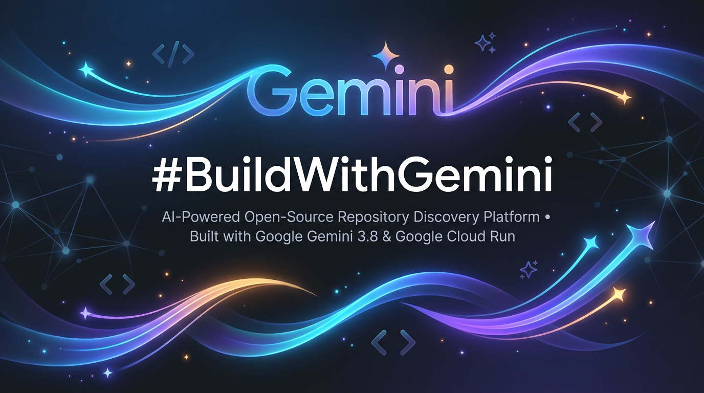
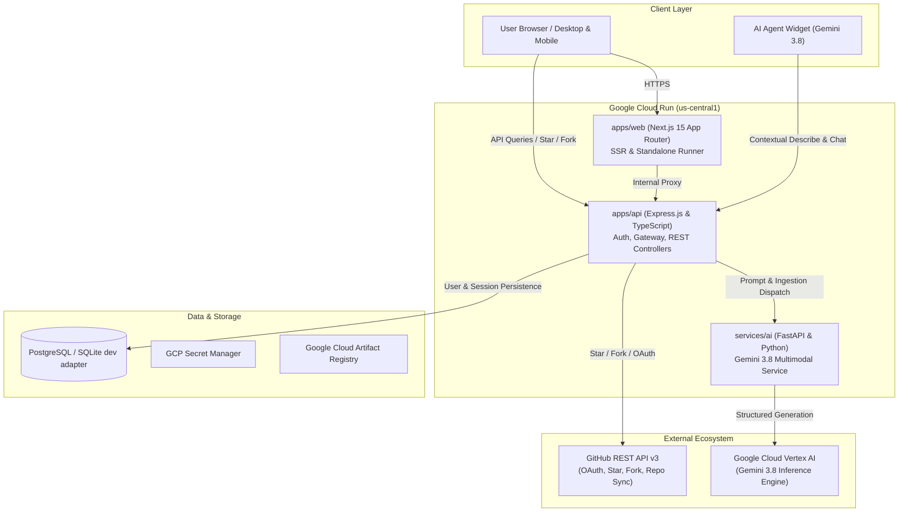

<p align="center">
  
</p>

# StackLoop — AI-Powered GitHub Discovery & Contribution Platform

<p align="center">
  <a href="https://github.com/aryanjsx/Stackloop"></a>
  <a href="https://cloud.google.com/run"></a>
  <a href="https://deepmind.google/technologies/gemini/"></a>
  <a href="https://nextjs.org"></a>
  <a href="https://www.typescriptlang.org"></a>
  <a href="https://fastapi.tiangolo.com"></a>
  <a href="LICENSE"></a>
</p>

---

## 🌟 Overview

**StackLoop** is an AI-powered developer platform designed to help engineers move seamlessly from **discovering open-source repositories** to **understanding their architecture**, **learning the required skills**, and **making meaningful contributions**.

Traditional discovery mechanisms like GitHub Trending or star counts surface projects based purely on vanity metrics. They don't tell a developer:
- *What does this repository actually do beneath the marketing buzzwords?*
- *What is the underlying software architecture and data flow?*
- *Is this project realistic for my current skill level, or is it too complex?*
- *Where should I look in the codebase to make my first pull request?*

StackLoop addresses this gap by combining **Google Gemini 3.8** multimodal intelligence, high-performance containerized microservices on **Google Cloud Run**, and a clean, responsive developer experience.

---

## 🚀 Live Demo Deployments

StackLoop is fully containerized and hosted in production on Google Cloud Run with zero-idle scaling (`--min-instances=0`):

| Service | Environment | Production URL |
| :--- | :--- | :--- |
| **Web Frontend** | Next.js 15 App Router | [https://stackloop-web-959507167485.us-central1.run.app](https://stackloop-web-959507167485.us-central1.run.app) |
| **API Gateway** | Express.js & TypeScript | [https://stackloop-api-959507167485.us-central1.run.app](https://stackloop-api-959507167485.us-central1.run.app) |
| **AI Engine** | FastAPI & Gemini 3.8 | [https://stackloop-ai-959507167485.us-central1.run.app](https://stackloop-ai-959507167485.us-central1.run.app) |

---

## ✨ Key Capabilities

### 1. 🤖 Gemini 3.8 Repository Intelligence
- **Deep Architectural Summaries:** Automatically generates component breakdowns, system design analyses, and data flow summaries directly from repository code and documentation.
- **Tradeoff & Quality Analysis:** Objectively highlights advantages, disadvantages, operational complexity, and production readiness.
- **Onboarding Checklists:** Step-by-step guides helping new developers spin up projects locally and navigate key files.

### 2. 💬 Persistent Bottom-Right AI Agent Widget
- Embedded across the entire application at `bottom-6 right-6`.
- **Route-Aware Context:** Detects when a developer is viewing a specific repository (`/repositories/:id`) and automatically injects that repository's metadata into the prompt context.
- **One-Click Quick Prompts:**
  - 📖 *Describe this repo*
  - 🏗️ *Explain Architecture*
  - ⚖️ *Pros & Cons / Tradeoffs*
  - 🚀 *How to get started*
- **Custom Inquiries:** Developers can ask freeform questions about code design, dependencies, or open-source recommendations.
- **Dynamic Preference Respect:** Immediately adapts its explanation tone, complexity, and examples based on the active user profile.

### 3. ⭐ Star, 🍴 Fork, & 🔗 Share Directly from the Web
- **Optimistic GitHub Star:** Star or unstar repositories in real-time. Syncs with both GitHub's API (using OAuth or Personal Access Token) and StackLoop bookmarks.
- **1-Click Fork Modal:** Authorize a fork into your personal GitHub account with one click, or jump directly to GitHub's native fork workflow.
- **Multi-Platform Share Modal:**
  - One-click shareable URL copy
  - Direct sharing to Twitter / X, LinkedIn, and Reddit
  - Native Web Share API integration on supported devices
  - Copyable Markdown badge (`[![StackLoop Discovery]...]`) for README documentation.

### 4. 👤 Developer Profile & AI Preferences (`/profile`)
- **Preferred Programming Languages:** Select or input target languages (TypeScript, Python, Rust, Go, C++, etc.).
- **Focus Topics & Domains:** Target specific domains (Machine Learning, DevOps & Cloud, Security, System Design, etc.).
- **Experience Level:**
  - `Beginner`: High-clarity explanations without jargon, focusing on fundamentals.
  - `Intermediate`: Balanced depth with practical implementation patterns.
  - `Advanced`: Deep architectural patterns, memory/scaling tradeoffs, and production bottlenecks.
- **AI Explanation Style:**
  - `Concise & Direct`: Executive bullet points and fast evaluation.
  - `Deep Architectural`: Modular boundaries and system mechanics.
  - `Beginner Friendly`: Plain English and guided analogies.
  - `Practical Code-First`: Starter snippets and actionable commands.
- **GitHub Personal Access Token (PAT):** Optional fine-grained PAT storage with an interactive **"Test Connection"** button verifying permissions live against `https://api.github.com/user`.

### 5. 🔍 Curated Repository Feed & Search
- Real-time search by repository name, owner, topic, or description.
- Multi-dimensional filtering by programming language and taxonomy categories.
- Sorting by Most Popular (stars), Most Forked, and Recently Updated.
- Verified badges for authentic open-source organizations.

---

## 🏛️ System Architecture

StackLoop is engineered as a clean, decoupled monorepo managed with **pnpm workspaces** and **Turborepo**:



---

## 📁 Repository Structure

```
Stackloop/
├── apps/
│   ├── web/                     # Next.js 15 App Router Frontend
│   │   ├── src/
│   │   │   ├── app/             # Routes: /, /repositories/[id], /profile, /dashboard, /auth
│   │   │   ├── components/      # AiAgentWidget, StarButton, ForkModal, ShareModal, Navbar
│   │   │   └── lib/             # API client, types, storage helpers, utility formatters
│   │   └── Dockerfile           # Multi-stage standalone production container
│   │
│   └── api/                     # Express.js REST Gateway
│       ├── src/
│       │   ├── auth/            # GitHub OAuth provider, JWT auth, user preferences
│       │   ├── repositories/    # Repo controllers, star/fork handlers, AI proxy
│       │   └── server.ts        # Express setup, security headers, rate limiting
│       └── Dockerfile           # Multi-stage Node.js container
│
├── services/
│   └── ai/                      # FastAPI AI Microservice
│       ├── app/
│       │   ├── routers/         # /summarize, /chat, /analyze endpoints
│       │   └── services/        # Vertex AI & Gemini 3.8 prompt pipelines
│       └── Dockerfile           # Python 3.11 container
│
├── assets/                      # Brand banners, posters, and design media
├── docs/                        # Architecture specs, PRD, database schemas, ADRs
├── cloudbuild-api.yaml          # Google Cloud Build pipeline for API
├── cloudbuild-web.yaml          # Google Cloud Build pipeline for Web
├── docker-compose.yml           # Local multi-service development setup
├── package.json                 # Monorepo scripts & dependencies
└── pnpm-workspace.yaml          # Workspace configuration
```

---

## 🛠️ Technology Stack

| Layer | Technology | Rationale |
| :--- | :--- | :--- |
| **Frontend Framework** | [Next.js 15](https://nextjs.org) (App Router) | Server-side rendering, instant page transitions, and modern React 19 architecture. |
| **Language** | [TypeScript 5](https://www.typescriptlang.org) | End-to-end type safety between frontend, backend, and API contracts. |
| **Styling & Icons** | [Tailwind CSS](https://tailwindcss.com) + [Lucide](https://lucide.dev) | High-performance, responsive dark-mode UI with sleek modern aesthetics. |
| **API Gateway** | [Express.js](https://expressjs.com) | Proven, battle-tested HTTP routing, robust middleware, and modular controller design. |
| **AI Intelligence** | [Google Gemini 3.8](https://deepmind.google/technologies/gemini/) via Vertex AI | State-of-the-art multimodal reasoning, high-fidelity code analysis, and low latency. |
| **AI Microservice** | [FastAPI](https://fastapi.tiangolo.com) (Python 3.11) | Pydantic schema validation, asynchronous execution, and native AI SDK integration. |
| **Data Layer** | [Prisma ORM](https://www.prisma.io) + PostgreSQL | Strongly typed database client, automated migrations, and high developer ergonomics. |
| **Cloud Infrastructure** | [Google Cloud Run](https://cloud.google.com/run) | Fully managed serverless containers with automatic scaling and zero idle billing. |
| **CI / CD Pipeline** | [Google Cloud Build](https://cloud.google.com/build) | Automated container builds and Artifact Registry publication. |

---

## 🔌 API Endpoints Reference

### 🔐 Authentication & Profile
| Method | Endpoint | Description |
| :--- | :--- | :--- |
| `GET` | `/auth/github` | Initiates GitHub OAuth flow requesting `public_repo` scope. |
| `GET` | `/auth/github/callback` | Exchanges authorization code for session tokens. |
| `GET` | `/auth/me` | Retrieves the currently authenticated user session. |
| `GET` | `/auth/profile/preferences` | Fetches saved user engineering preferences. |
| `PATCH`| `/auth/profile/preferences` | Updates preferred languages, domains, level, style, and PAT. |
| `POST`| `/auth/logout` | Clears active authentication cookies and revokes session. |

### 📦 Repository Discovery & Operations
| Method | Endpoint | Description |
| :--- | :--- | :--- |
| `GET` | `/repositories` | Paginated repository list with sorting, searching, and filters. |
| `GET` | `/repositories/:id` | Detailed repository metadata including technologies and categories. |
| `POST`| `/repositories/:id/star` | Stars/unstars repository on StackLoop and GitHub via user token/PAT. |
| `POST`| `/repositories/:id/fork` | Performs automated fork via GitHub API or returns direct fork URL. |
| `POST`| `/repositories/:id/ai-describe` | Generates on-demand Gemini 3.8 insights tailored to user preferences. |
| `POST`| `/repositories/ai-discover` | Conversational open-source discovery driven by Gemini 3.8. |

### 🩺 Health & System
| Method | Endpoint | Description |
| :--- | :--- | :--- |
| `GET` | `/health` | Cloud Run liveness probe returning HTTP 200 OK. |

---

## 💻 Local Development Setup

### Prerequisites
- **Node.js** >= 20.x
- **pnpm** >= 9.x (`npm install -g pnpm`)
- **Python** >= 3.11
- **Docker** & **Docker Compose** (optional, for local PostgreSQL)

### 1. Clone the Repository
```bash
git clone https://github.com/aryanjsx/Stackloop.git
cd Stackloop
```

### 2. Install Workspace Dependencies
```bash
pnpm install
```

### 3. Environment Variables Setup
Copy the example environment file:
```bash
cp configs/env/.env.example .env
```
Key configuration settings:
```env
PORT=4000
NODE_ENV=development
JWT_SIGNING_SECRET=your-secure-random-jwt-secret-at-least-32-chars
GITHUB_CLIENT_ID=your_github_client_id
GITHUB_CLIENT_SECRET=your_github_client_secret
GITHUB_REDIRECT_URI=http://localhost:3000/auth/callback
WEB_APP_ORIGIN=http://localhost:3000
AI_SERVICE_URL=http://localhost:8000
GEMINI_API_KEY=your_gemini_api_key
```

### 4. Run Development Servers
Start both the Next.js frontend and Express API concurrently:
```bash
# Start API (port 4000) and Web (port 3000)
pnpm dev
```

Visit **[http://localhost:3000](http://localhost:3000)** in your browser.

### 5. Typecheck and Build Verification
```bash
# Typecheck entire monorepo
pnpm --filter @stackloop/api typecheck
pnpm --filter @stackloop/web typecheck

# Production build
pnpm --filter @stackloop/web build
```

---

## ☁️ Google Cloud Deployment

StackLoop is pre-configured for automated deployment to Google Cloud Run using Google Cloud Build and Google Artifact Registry:

```bash
# 1. Build and push container images to Artifact Registry
gcloud builds submit --config cloudbuild-api.yaml \
  --substitutions _TAG="us-central1-docker.pkg.dev/$PROJECT_ID/stackloop-repo/stackloop-api:latest"

gcloud builds submit --config cloudbuild-web.yaml \
  --substitutions _TAG="us-central1-docker.pkg.dev/$PROJECT_ID/stackloop-repo/stackloop-web:latest"

# 2. Deploy to Cloud Run with zero idle costs
gcloud run deploy stackloop-api \
  --image="us-central1-docker.pkg.dev/$PROJECT_ID/stackloop-repo/stackloop-api:latest" \
  --region=us-central1 \
  --min-instances=0 \
  --allow-unauthenticated

gcloud run deploy stackloop-web \
  --image="us-central1-docker.pkg.dev/$PROJECT_ID/stackloop-repo/stackloop-web:latest" \
  --region=us-central1 \
  --min-instances=0 \
  --allow-unauthenticated
```

---

## 🛡️ Security & Privacy

- **Minimal OAuth Permissions:** StackLoop only requests permissions required for public repository reading and starring/forking actions.
- **Token Hygiene:** Personal Access Tokens are held securely in client session storage and never persisted in database logs.
- **Untrusted Input Protection:** README documents and repository code are treated strictly as untrusted text to prevent prompt injection and markdown-based XSS attacks.
- **Zero Idle Billing:** Cloud Run instances scale down to 0 instances when idle, preventing accidental resource consumption.

---

## 👤 Author

**Aryan Kumar**
- GitHub: [@aryanjsx](https://github.com/aryanjsx)
- Email: [kumararyan1929@gmail.com](mailto:kumararyan1929@gmail.com)

---

## 📄 License

This project is licensed under the **Apache 2.0 License** — see the [LICENSE](LICENSE) file for details.
