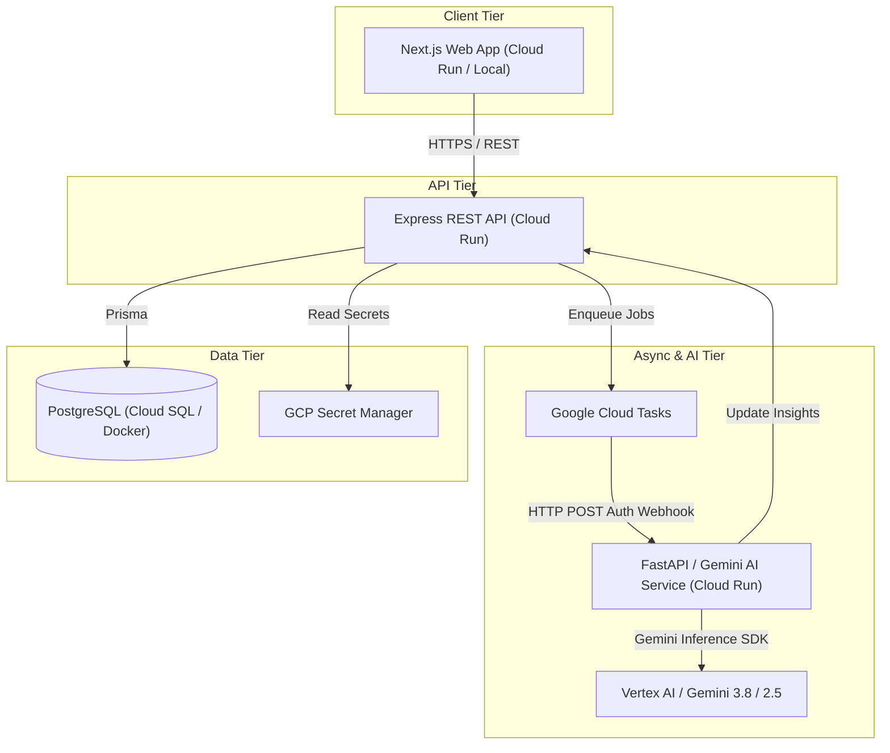

# StackLoop Rebuild Plan

- **Author:** Staff Product & Systems Architect
- **Target:** Production MVP Deployed on GCP / Local Dev Baseline
- **Date:** 2026-10-13

---

## 1. Objectives & Principles

This plan governs the rebuild of StackLoop from the verified `apps/api` baseline to a deployed, AI-powered developer discovery platform.

### Principles:
1. **Preserve Verified Code:** Do not rewrite the working, tested auth and validation engine in `apps/api`.
2. **Thin Vertical Slices First:** Prove end-to-end data flow (Web -> API -> DB -> Client) before adding complex background or recommendation features.
3. **No Mocks in Production Paths:** Use disposable PostgreSQL for integration tests; verify real queries and foreign-key constraints.
4. **Cloud Cost Discipline:** Keep GCP resources serverless or auto-scaled to zero; clean up and stop all non-essential resources immediately.

---

## 2. Target Architecture

---

## 3. Phased Implementation Roadmap

### Phase 0: Audit & Architecture Decisions (Current)
- **Deliverables:**
  - `docs/repository-audit.md`
  - `docs/rebuild-plan.md`
  - `docs/adr/0002-cloud-hosting-gcp-vs-azure.md`
  - `docs/adr/0003-async-processing-cloud-tasks.md`
  - Updated `docs/phase-tracker.md`
- **Definition of Done:** Decisions recorded, verified against code, cloud architecture agreed before provisioning.

### Phase 1: Engineering Foundation & Database Readiness
- **Deliverables:**
  - Add root `docker-compose.yml` for PostgreSQL.
  - Setup `.github/workflows/ci.yml` (install, typecheck, test, build).
  - Add database integration tests verifying Prisma against PostgreSQL.
  - Add rich development seeds with real technologies and categories.
- **Definition of Done:** `pnpm test` runs cleanly locally and in CI against a real PostgreSQL instance.

### Phase 2: Production-Grade Repository & API Endpoints
- **Deliverables:**
  - Expand `apps/api/src/repositories/` with public endpoints:
    - `GET /repositories`: Paginated, filterable feed (language, topic, stars).
    - `GET /repositories/:id` & `GET /repositories/:owner/:name`: Full repository details.
    - `POST /repositories/:id/save` and `DELETE /repositories/:id/save`: User save/bookmark actions.
    - `GET /users/me/saved`: Saved repositories list.
- **Definition of Done:** API endpoints covered with authenticated and unauthenticated test suites.

### Phase 3: First Usable Vertical Slice (Next.js Frontend)
- **Deliverables:**
  - Scaffold `apps/web` (Next.js 15 App Router, TypeScript, Tailwind CSS).
  - Implement core pages per Design System spec:
    - `/` Landing & Discover Feed.
    - `/repositories/[id]` Repository Detail view.
    - `/auth/callback` OAuth callback handler.
    - `/dashboard` User Dashboard showing saved repositories.
- **Definition of Done:** A visitor opens the web app, searches/filters repos, signs in with GitHub, saves a repo, and verifies it persists on the dashboard after a hard refresh.

### Phase 4: Gemini AI Service & Cloud Tasks Integration
- **Deliverables:**
  - Scaffold `services/ai` with Python FastAPI and Google GenAI / Vertex AI Gemini 3.8.
  - Implement schema-constrained prompt pipelines for:
    - Repository summary & value proposition.
    - Technology stack detection.
    - Difficulty rating (Beginner, Intermediate, Advanced) and onboarding time estimate.
  - Implement Cloud Tasks webhook handler with HMAC authentication.
- **Definition of Done:** Syncing a repository triggers an AI generation job that enriches PostgreSQL with structured AI insights visible in the web UI.

### Phase 5: Cloud Deployment & Teardown Protocol
- **Deliverables:**
  - Cloud Run service definitions for `web`, `api`, and `ai`.
  - Secret Manager integration.
  - Automated deployment scripts and immediate teardown runbook for cost control.
- **Definition of Done:** Application is reachable, verified on GCP, and unused resources can be stopped with a single command.
